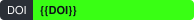
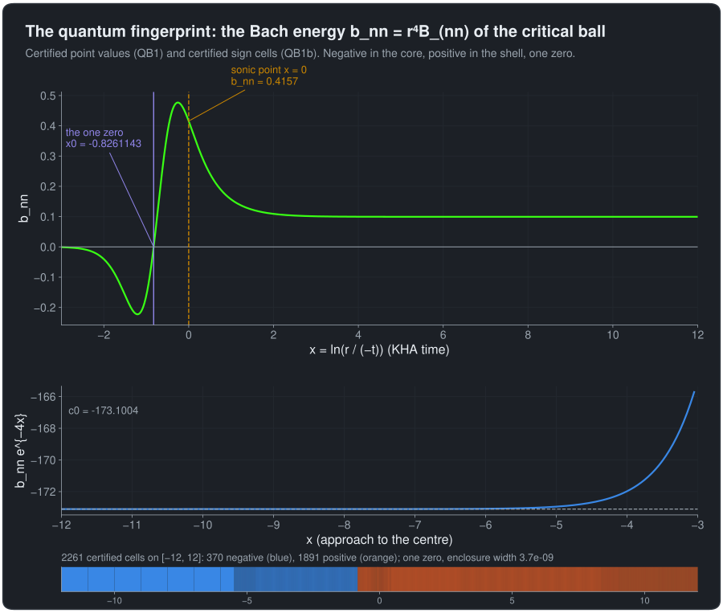
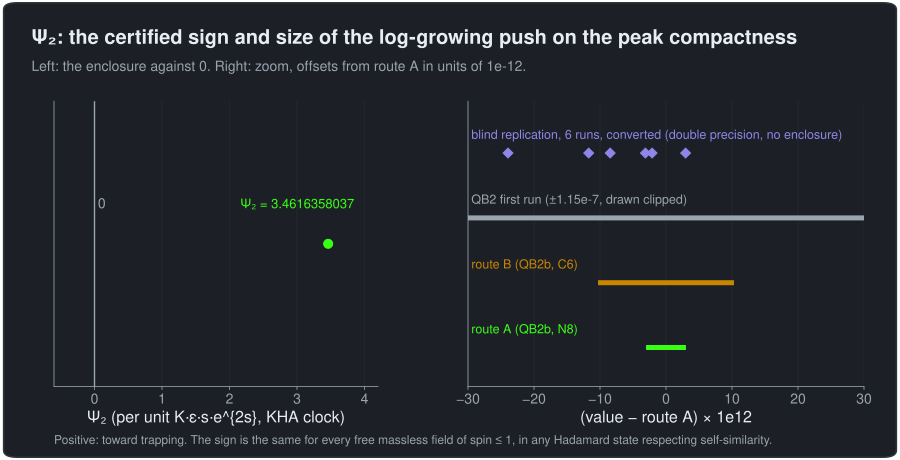
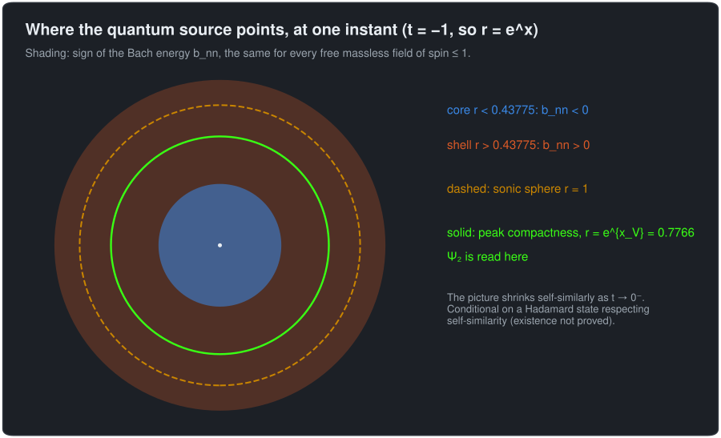
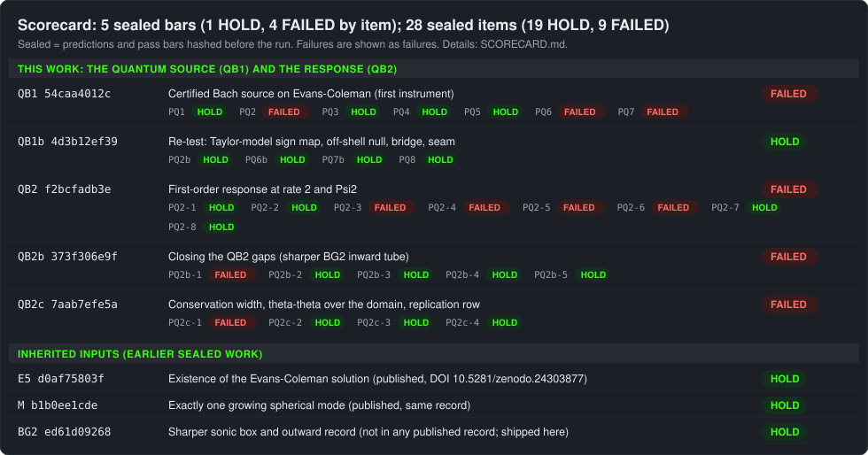

# Which way does the quantum world push a ball of light?

Moki & Julio (AI-assisted) · 2026 · version 1.0

**The magic trick.** Every free massless quantum field of spin up to 1 leaves the same fingerprint on the critical ball of light,
the Bach tensor. A computer proof maps that fingerprint from x = −12 (next to the centre) out to x = 12: negative in the core, positive in
the shell, with exactly one sign change on that range. Then it reads the fingerprint on the sphere near x ≈ −0.25 where
the gas of light stands still and 2m/r peaks locally. There, the slowly growing quantum push raises (toward trapping) the ball's peak
compactness.

## In plain words

When a ball of light (a gas of radiation) collapses under its own gravity, a tiny change in the starting push decides
its fate: it becomes a black hole or it flies apart. Exactly on the dividing line sits a special collapse that keeps
its shape while it shrinks, the **Evans-Coleman critical solution**. In earlier work we proved that it exists and that
it has exactly one way to fall ([certified-evans-coleman](https://doi.org/10.5281/zenodo.24303877)).

That proof used Einstein's gravity alone, with no Planck's constant ħ. In the real world, quantum fields live on the
collapsing ball and add a small extra stress. Most of that stress depends on the quantum state the fields are in, which
nobody knows here. One piece does not. It is fixed by the shape of spacetime alone, and it grows slowly but without limit
as the collapse goes on.

Two earlier results give that piece its form. Zahn proved the general result for scalar fields in 2025. Brady and
Ottewill had found the same structure for conformal fields in 1998. On a radiation background that piece is one
curvature quantity, the **Bach tensor**, times a positive number that only counts which fields are present. So every
free massless field (scalars, massless spin-1/2 fields, photons) presses with the same finger; only how hard it presses differs.

**What we did.**

1. We evaluated the Bach tensor on the certified critical solution with **ball arithmetic**. Every number carries a
   guaranteed error radius, and every rounding goes outward, so the outputs are proved bounds, not estimates.
   - Its energy component is **negative in the core** and **positive in the shell**.
   - From the centre out to x = 12 it changes sign **exactly once**, on the sphere r ≈ 0.4377 × (time left before the
     collapse ends, in the time of Koike, Hara and Adachi; 0.354 × in the proper time of the centre).
   - At the sonic sphere (where the gas moves at the speed of sound relative to the shrinking pattern) its fluid-frame
     value is 0.44667377966953663 ± 1.5e-17. At the centre its coefficient is −173.10044439229957 ± 3.1e-13.
2. We solved for how the collapsing ball answers this push, to first order in ħ.
3. We read the answer on the sphere near x ≈ −0.25 where 2m/r peaks locally. That reading is the same in every coordinate system. Its sign is
   **positive**: the slowly growing quantum push **raises (toward trapping)** the peak compactness.

**What we did not do.** We did not prove which way ħ moves the black-hole threshold. That needs the unknown
state-dependent part, so we state it as a **conjecture** under named conditions.

**The idea in one picture.** A fingerprint pressed onto a shrinking balloon: every quantum field uses the same finger
and only presses harder or softer. **Where the picture breaks.** The finger also depends on a quantum state, which we
assume is itself self-similar. Nobody has proved that such a state exists on this background.

[](https://doi.org/{{DOI}})  [](https://github.com/Hashirama1337s)

**Read** [paper.md](paper.md) · **Re-run** [tools/reproduce.md](tools/reproduce.md) · **Check** [CLAIMS.md](CLAIMS.md) and [SCORECARD.md](SCORECARD.md)



*The quantum fingerprint. Top: b_nn = r⁴B_(nn) against x = ln(r/(−t)) on [−3, 12], from the certified point values of QB1; the sonic point x = 0 (b_nn = 0.4157) and the single zero x0 = −0.8261143 are marked. Middle: the approach to the centre, b_nn·e^{−4x} on [−12, −3], tending to c0 = −173.1004 (dashed). Bottom: the 2261 certified QB1b cells coloured by sign (370 negative, 1891 positive); one zero, enclosure width 3.7e-9. The error bars are far thinner than the line. Nothing beyond x = 12 is certified. Holds in any Hadamard state respecting self-similarity (existence on Evans-Coleman not proved).*

## At a glance

Every claim below holds **in any Hadamard state respecting self-similarity (Zahn eq. 4); existence of such a state on
Evans-Coleman is not proved.**

- **Cited, not new.** On a background with zero Ricci scalar, Zahn's state-independent tensor is V = Bach/60 for every
  curvature coupling. This is a one-line consequence of Zahn (2025) and R = 0, and radiation has R = 0.
  - Scalars rest on Zahn's theorem.
  - Spin 1/2 and Maxwell rest on Brady and Ottewill's exact conformal transformation law.
  - The field multipliers are positive: 1 per scalar, 6 per Dirac fermion, 12 per Maxwell field.
- **QB1/QB1b (computer-assisted, HOLD).** These are certified on the Evans-Coleman solution:
  - the full sign map of b_nn = r⁴B_(nn) on x ∈ [−12, 12], in 2261 cells;
  - exactly one sign change, at x ∈ [−0.826114343480, −0.826114339753] (rounded outward);
  - the sonic-point value b_uu = 0.44667377966953663 ± 1.5e-17;
  - the centre coefficient c0 = −173.10044439229957 ± 3.1e-13, with exact isotropy at the centre.
  - The sign of the source is the same for every field at every point. Because b_nn changes sign, QB1 alone gives
    **no** single direction of the quantum push.
- **QB2, QB2b, QB2c (computer-assisted; the headline item HOLDs in all three sealed bars, and each bar FAILED by item).**
  - The response to the slowly growing source is fixed by geometry and unique up to a coordinate (gauge) mode; four
    lemmas are proved in the paper.
  - The change of the local peak compactness is Ψ2 ∈ [3.4616358037141656915 ± 3.02e-12] (per unit K·ε·s·e^{2s} in the Koike-Hara-Adachi clock, K = N_c/(30π), ε = ℓ_P²/t0²; Ψ2 = δ(2m/r) at x_V), read at the sphere
    x_V ∈ [−0.25278710208307181878 ± 1.14e-20] where the fluid velocity vanishes.
  - Ψ2 is **positive**. It is invariant under every infinitesimal change of coordinates.
  - For photons alone (N_c = 12): K·Ψ2 = 0.440749159476; per unit N_c: 0.036729096623.
  - Not claimed: a conservation width ≤ 1e-10. The matching check e encloses 0 at width 6.66e-10; the sealed 1e-10 width bar FAILED in QB2 and QB2b; in QB2c it was not run as sealed, because a probe showed the tight stage cannot move the width (the QB2b value is replayed). Our estimate of the floor, from that probe and not a certificate: the step balls of the pinned inward background tube.
- **Conjecture, not result.** Under stated infrared-naturalness conditions and a linear extrapolation, sgn Ψ2 is the
  direction in which ħ moves the black-hole threshold for radiation: quantum effects would favour black-hole formation (lower the threshold).
- **Prior art.** To our knowledge, after a prior-art search (17 November 2026; refreshed 18 November 2026),
  no earlier work evaluates the one-loop state-independent source on the Evans-Coleman background or certifies any
  semiclassical quantity on a true critical-collapse solution.
  - The structure is Brady-Ottewill's (1998) and Zahn's (2025).
  - Closed-form toy-model results are Tomasevic and Wu's (2025-26).
- **Checked.**
  - Sealed tests: QB1 FAILED by item (four items HOLD, three FAILED), re-tested as QB1b, which HOLDs.
    QB2, QB2b and QB2c each FAILED by item. The headline Ψ2 held in all three (PQ2-8, PQ2b-5, PQ2c-3). The conservation width bar failed in QB2 and QB2b and was not run as sealed in QB2c (FAILED).
  - A blind second implementation (own formulation, double precision, no enclosure) converts exactly by 30π x_s²/A(x_V) and agrees with Ψ2 to relative 6.9e-12 or better over six runs (QB2c PQ2c-4, HOLD; the conversion was found after both numbers existed).
  - The centre coefficient has the exact closed form c0 = −(2/3)W0(8W0 − 3)e^{−4xc} (QB2b PQ2b-2, HOLD; re-derived independently by an internal referee).
  - An internal referee's independent code reproduces the sonic value to 25 digits and c0 to 22.
  - Two internal hostile referee rounds were held before any build, and two more on the QB2 results (unit
    reconciliation; lemmas v2 and centre formulas); their fixes are in the text.
  - An off-shell content null refuses as it must.
  - Clean-room replay (18 November 2026): quick tier 16/16 IDENTICAL; BG2 tier box, outward record and gate IDENTICAL; the 7-hour full tier was not replayed.
- **Conditions.** Ball arithmetic (arb) is trusted. Classical theorems (Frobenius, majorants, Danskin, Rouché) are used
  without proof. No step is Lean-checked.

## What we do not claim

- **Not the state.** The existence of a self-similar Hadamard state on Evans-Coleman is not proved. Every claim is
  conditional on it.
- **Not the threshold.** Which way ħ moves black-hole formation is a **conjecture**. The threshold depends on the
  trapping function at its extremum, not at the sphere where we read Ψ2. It also needs (i) a renormalised coupling of
  natural size at the initial-data scale, (ii) a state normalised there, and (iii) a state-dependent part small against
  ln(t0/ℓ_P). It further needs the Tomasevic-Wu linear extrapolation, at a curvature only a logarithm below Planck.
- **Not "the sign of the quantum push" from QB1.** The Bach energy changes sign between core and shell.
- **Not a quantised fluid.** The quantum fields are independent free fields on a classical background. "The fluid's
  own photons" (multiplier 12) is an interpretation, and double counting is not addressed.
- **Not beyond first order in ħ**, and not beyond the window where the correction is small. The quantum source breaks
  exact self-similarity, as Chiba and Siino state (we know their paper only from its abstract).
- **Not the whole spacetime.** Everything is before the collapse ends (t < 0). The Cauchy horizon is excluded, and the
  sign map stops at x = 12.
- **Not the state-dependent part** of the stress tensor.
- **Not spin > 1.** Spin 1/2 and Maxwell are covered only as conformal fields, through Brady-Ottewill's law.
- **The two computation routes** agree in 28 comparisons at 19 distinct x. That tests the algebra, not independent physics.
- Review status: Four internal hostile referee seats on the science (referee-1 on QB1; referee-2 on the QB2 design v1; referee-3 on the QB2 result against the blind seat; referee-4 on the QB2 lemmas v2 and the centre formulas), every fix applied; release-text referee: referee-5, two rounds, final verdict CORRECT WITH FIXES, all fixes applied. Prior-art refresh to 18 November 2026. These are internal checks, not external peer review.

## How it works

### Step 1 - the idea (for anyone)

```mermaid
flowchart LR
  A[Certified critical ball of light] --> B[Quantum stress: state part + geometric part]
  B --> C[Geometric part = Bach tensor x positive field count]
  C --> D[QB1b: certified Bach map, core negative, shell positive, one zero]
  D --> E[QB2: solve the ball's first-order response at rate 2]
  E --> F[Read the change of peak compactness where the gas stands still]
  F --> G[Psi2: certified sign, same for every field]
  G -.conjecture.-> H[Which way the black-hole threshold moves]
```



The critical solution keeps its shape while it shrinks, so everything depends on one variable, x = ln(r/(−t)). That
turns the field equations into ordinary differential equations. The quantum piece grows like s·e^{2s}, where
s = −ln(−t). It is slow (one power of a logarithm faster than e^{2s}) but relentless.



*Ψ2 = [3.4616358037141656915 ± 3.02e-12], far from 0 (left). Right, offsets from route A in units of 1e-12: route B (variation of constants and the adjoint) overlaps; the first sealed run (±1.15e-7) contains both; six blind double-precision runs, converted exactly, sit within 2.4e-11 (no enclosure: a replication, not a certificate).*



*A cross-section of the ball at t = −1, so r = e^x. Core r < 0.43775: Bach energy negative; shell: positive. Dashed: the sonic sphere r = 1. Solid: the sphere of local peak compactness r = e^{x_V} = 0.7766, where Ψ2 is read. The picture shrinks self-similarly as t → 0⁻; the shading is the same for every field of spin ≤ 1; conditional on the self-similar Hadamard state.*

### Step 2 - how it works (for a curious student)

**The source.** The Bach tensor needs up to fourth derivatives of the metric. We compute it two ways:

- Route A uses Einstein's equations to replace curvature by the fluid.
- Route B uses only the metric.

Both are evaluated in a polar chart and a chart that is regular at the centre. Before the main run, the same code must
reproduce:

- Zahn's exact Hayward values (1/80, 17/240, −7/480);
- Reissner-Nordström closed forms;
- zero on flat space;
- a curvature-coupling dependence on a k = 1/2 Friedmann universe, where R ≠ 0 and the coupling must show up.

Flipping one sign in the formula makes the Hayward check fail, as it must.

**The sign map.** The first attempt checked signs at 691 points but could not cover whole intervals. Plain interval
evaluation of b_nn overestimated by factors of 10⁴ to 10²⁰, so that sealed item FAILED. The re-test uses Taylor
models: each cell gets a polynomial in the distance from its centre plus a rigorous remainder. With 2261 cells it
covers [−12, 12] with no gap. At the sign change, the slope is proved positive (at least 1.165), so the zero is unique.

**The response.** Lemma by lemma (paper, Section 5):

- (a) A conserved source keeps the constraints solved.
- (b) The sonic point lets through a two-parameter family of smooth solutions.
- (c) So does the regular centre.
- (d) Because 2 is not a growth rate of the ball (certified: D_new(2) = −2.41262708580 ± 1.2e-9), the two families
  meet in exactly one solution, up to a coordinate (gauge) mode.

**The readout.** The quantity 1 − 2m/r equals 1/A exactly, and A peaks where the fluid velocity vanishes. At that peak
the gradient of 2m/r is zero in every direction. So the first-order change there cannot be moved by any change of
coordinates. That change is Ψ2.

### Step 3 - the real thing (for specialists)

- **Source.** Zahn's eq. 19 on R ≡ 0 gives V = B/60. Frame profiles b_ab = r⁴B_(ab) in the Eulerian frame are evaluated
  on the E5 Lohner tube, the certified sonic and centre manifolds, and the outward record to x = 12.
- **Sign map.** Taylor models of degree 5-7 in a direct (s, r) chart, plus a w = z² Cauchy-tail series for x ≤ −11/2
  with a Rouché check. The zero is enclosed by degenerate-Taylor-model bisection.
- **Forced problem.** The HKA pencil Q Y′ = (P0 + 2P1)Y + S(σ) with a four-row source, since the source reaches the
  fluid rows too.
  - The constraint obeys J′ = −AJ − A·D_t(σ).
  - The forced sonic Frobenius step has ρ(2) ≤ −1.9085, and Δ2(2) ≠ 0 follows from κ_pole = d.
  - The centre source orders are (v², v², v², v³).
  - Matching at x_m = −4.6 uses D_HKA(2) = −19.942295268 ± 1.2e-8.
- **Observable.** Ψ2 = Ā_2(x_V)/A(x_V), through Danskin on U = [−0.30, −0.20].
- **Checks.** Route B by variation of constants and the adjoint; a manufactured gauge solution; a manufactured
  conserved source; non-conserved and wrong-background nulls.
- [paper.md](paper.md) has the exact hypotheses, the lemmas and every sealed item. [CLAIMS.md](CLAIMS.md) maps every
  number to its result file.



*Every sealed bar and item, failures included ([SCORECARD.md](SCORECARD.md)):*

- QB1 PQ1, PQ3, PQ4, PQ5: HOLD;
- QB1 PQ2, PQ6, PQ7: FAILED;
- QB1b PQ2b, PQ6b, PQ7b, PQ8: HOLD;
- QB2 PQ2-1, PQ2-2, PQ2-7, PQ2-8: HOLD; PQ2-3 to PQ2-6: FAILED;
- QB2b PQ2b-1: FAILED; PQ2b-2 to PQ2b-5: HOLD;
- QB2c PQ2c-1: FAILED; PQ2c-2 to PQ2c-4: HOLD.

| test | seal | verdict |
|---|---|---|
| QB1: certified source at sonic point, centre, 28 route comparisons, controls | 54caa4012c | 4 items HOLD |
| QB1: covering sign map (PQ2) | 54caa4012c | FAILED |
| QB1: off-solution null (PQ6) | 54caa4012c | FAILED (ill-posed null) |
| QB1: D_new(2) bridge (PQ7) | 54caa4012c | FAILED (wrong matching point) |
| QB1b: Taylor-model sign map + unique zero, off-shell null, D_new(2), seam | 4d3b12ef39 | HOLD |
| QB2: source, rows, location, headline Ψ2 (PQ2-1, -2, -7, -8) | f2bcfadb3e | HOLD by item |
| QB2: conservation width, centre 1e-30, controls, nulls (PQ2-3 to -6) | f2bcfadb3e | FAILED |
| QB2b: conservation width with the BG2 tube (PQ2b-1) | 373f306e9f | FAILED (width 6.66e-10) |
| QB2b: exact centre, domain lemma, controls and nulls, headline replay (PQ2b-2 to -5) | 373f306e9f | HOLD by item |
| QB2c: conservation width with a tighter stage (PQ2c-1) | 7aab7efe5a | FAILED (not run as sealed: a probe showed the tight stage cannot move the width; the QB2b value is replayed) |
| QB2c: θθ at five points (N-b at x = −4.6 on a representation chosen POST HOC), headline replay, replication row (PQ2c-2 to -4) | 7aab7efe5a | HOLD by item |

## Use it as a tool

- **Questions it answers.**
  - What is the one-loop geometric quantum source on the Evans-Coleman solution, with guaranteed bounds, at the sonic
    point, at the centre, and where does it change sign?
  - What does the first-order response at rate 2 do to the peak compactness?
- **Reproduce.** From the repository root (details and every step in [tools/reproduce.md](tools/reproduce.md)):
  - `python tools/check_pins.py`: every pinned file against its ledger pin, every file against `MANIFEST.sha256`;
  - `python tools/reproduce.py --tier quick` (about 30 minutes on one core, lab times): the symbolic derivations, the QB1 main run, the QB1b tasks and one sign-map region, the exact centre, and the QB2c replay of the matching, the readout, the θθ residual and the replication row;
  - `python tools/reproduce.py --tier full` (about 7 hours on one core, lab times): every sealed run, including the full sign map and both certified transport passes, with every data file regenerated;
  - `python tools/reproduce.py --tier bg2` (about 70 minutes): the BG2 sonic box, outward record and gate;
  - Python 3.11 and python-flint 0.9.0 (also sympy, mpmath, numpy; scipy for the blind seat).
  - Expected last line: `[reproduce] ALL CHECKS PASS`.
  - Loading a pickle can execute code. The quick tier loads a shipped pickle only after its sha256 matches; the full tier regenerates every pickle from source.
- **Reuse.**
  - A metric-in, Bach/Zahn-tensor-out module with ball arithmetic.
  - Taylor-model sign maps of a removable-singularity profile through a sonic point.
  - A forced-response solver for self-similar linear problems, with a conservation check that has teeth.

## Words you will meet

- **Critical solution**: the solution sitting exactly on the boundary between collapse to a black hole and dispersal.
- **Self-similar**: keeps its shape while it shrinks.
- **One-loop / first order in ħ**: the smallest quantum correction, proportional to Planck's constant.
- **Hadamard state**: a quantum state whose short-distance behaviour is that of empty space, the standard class in
  which the stress tensor can be renormalised.
- **Bach tensor**: a curvature tensor built from the Weyl tensor; it vanishes in a conformally flat spacetime.
- **Sonic point**: where the fluid moves at the speed of sound relative to the shrinking pattern.
- **Gauge mode**: a fake change caused by relabelling coordinates.
- **Peak compactness**: the largest value of 2m/r near the core; 2m/r = 1 marks a trapped surface.
- **Ball arithmetic / Taylor model**: numbers, or polynomials, that carry guaranteed error bounds.
- **Sealed test**: a prediction and its pass bar, hashed before the run and scored as written.
- **Seat**: a separate internal working session of the lab with its own files. Referee seats are internal checks, not
  external peer review.

## Open doors

What this work leaves open, for anyone who wants to take the next step.

- **Which way ħ moves the threshold.** The Tomasevic-Wu sign rule turns this into one sign at the extremum of the
  trapping function. That sign needs the state-dependent part.
  - *Status:* open according to Tomasevic and Wu (arXiv:2509.03587, who call radiation-fluid collapse "the important
    next step") and Wu (arXiv:2610.20705, for a large-D DSS scalar model: the direct contribution "can favor or oppose trapping"). Brady and Ottewill
    called the sign an assumption.
  - *Start here:* the response profile h2 and the extended threshold algebra (paper.md, Section 7.4).
  - *Ceiling:* the direction in which Planck's constant moves black-hole formation for radiation.
- **A self-similar quantum state on this background.** Every theorem here assumes one.
  - *Status:* open according to Zahn (arXiv:2509.10360), who proves existence on three other backgrounds and argues
    persistence "though not rigorously".
  - *Ceiling:* the condition dropped from every claim in this repository.
- **Four dimensions against two.** Zahn notes that 2D models have no log term, and Tomasevic and Wu note that
  "dimensional reduction and quantization do not commute in general".
  - *Status:* UNTESTED observation from this work: nobody we found has compared both on the same true critical solution.
  - *Start here:* the four-row source of paper.md, Section 5; a 2D s-wave source would replace σ.
  - *Ceiling:* a certified measurement of what the 2D shortcut changes on a real critical collapse.

## Fairness

- **Brady and Ottewill (1998)** found the structure this work stands on: the quantum rate 2, the log-growing Bach term,
  and its renormalisation freedom. They also said plainly that the sign could not be settled "without a complete
  calculation".
- **Zahn (2025)** proved the scalar theorem and noted that, at conformal coupling, the state-independent tensor reduces to a
  multiple of the Bach tensor.
- **Tomasevic and Wu (2025-26)** and **Wu (2026)** solved toy models in closed form, gave the threshold sign rule, and
  named radiation as the next step, by simulation. Ours is a certified linear-order coefficient on a proved background,
  a different kind of result, and it does not replace their planned simulation.
- **Ayal and Piran (1997)** did an early numerical semiclassical study of scalar-field collapse and flagged the centre divergence of their
  2D-derived tensor.
- **Berczi, Saffin and Zhou (2021)** simulated semiclassical Choptuik collapse numerically and found that Choptuik
  scaling survives (arXiv:2111.11400; abstract).
- **Chiba and Siino (1997)** state, in a two-dimensional model, that exact self-similarity does not survive
  semiclassically. We know this work only
  from its abstract.
- **Gundlach, Hilditch and Martín-García** review critical collapse and its quantum section.
- **Duff** gives the standard anomaly weights we use for the field count.
- Our own corrections are listed in paper.md, Section 9.2. They include three sealed items that FAILED, a wrong
  coefficient reading in an internal note, and a source bug caught by an internal referee before any build ran.

## How to cite

```
Moki & Julio (2026). The quantum fingerprint on the critical ball of light: a certified one-loop Bach source on the Evans-Coleman solution, and the sign of its secular push on the peak compactness. Version 1.0. Zenodo. https://doi.org/{{DOI}}
```

Machine-readable: [CITATION.cff](CITATION.cff). Text and data: CC BY 4.0 (`LICENSE`). Code: MIT (`LICENSE-CODE`).

## Related projects

- [certified-evans-coleman](https://github.com/Hashirama1337s/certified-evans-coleman): the critical ball of light exists and has exactly one way to fall (the background used here)
- [certified-page-time](https://github.com/Hashirama1337s/certified-page-time): certified Page evaporation constants of a Schwarzschild black hole
- [certified-bowen-york-spin](https://github.com/Hashirama1337s/certified-bowen-york-spin): the certified spin ceiling of Bowen-York black holes
- All projects: [the Moki & Julio lab map](https://github.com/Hashirama1337s)

---

*Prepared with AI assistance; what was checked, and by what, is stated above.*
